# Assignment 1 Testing File

Name(s): Owen Cobbold

## start.php

Loki Link: [start.php Loki](https://loki.trentu.ca/~owencobbold/3430/assn/assn1-OwenCobbold21/start.php)

### Empty Username Error

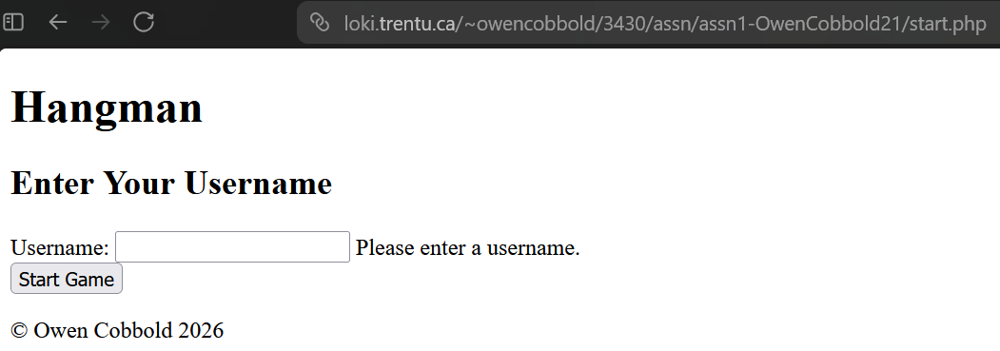

### Invalid Character Error

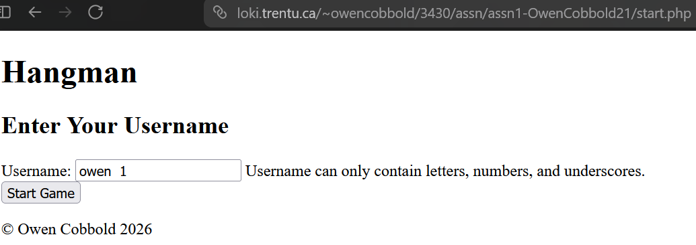

### Successful Redirect

### HTML start Validation

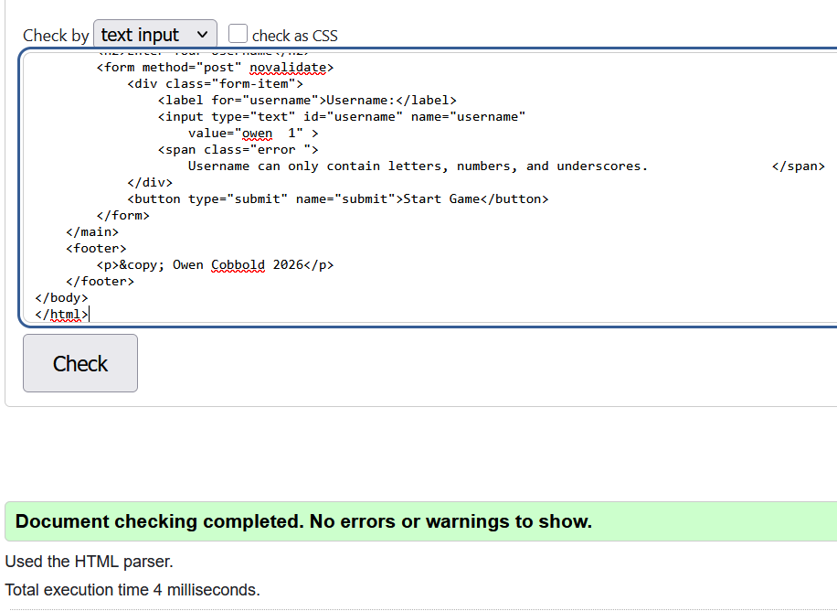

## difficulty.php

Loki Link: [difficulty.php Loki](https://loki.trentu.ca/~owencobbold/3430/assn/assn1-OwenCobbold21/difficulty.php)

### No Difficulty Selected Error

### Easy Selected

### Medium Selected

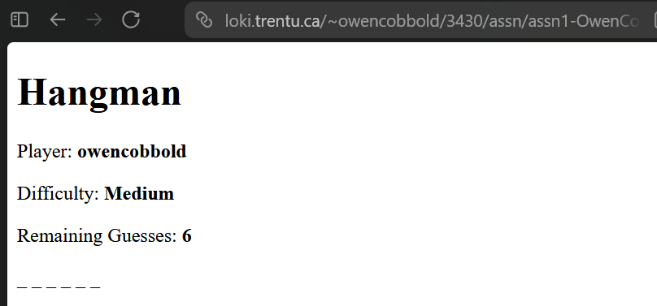

### Hard Selected

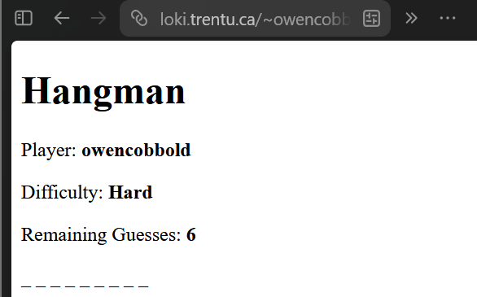

### HTML difficulty Validation

## play.php

Loki Link: [play.php Loki](https://loki.trentu.ca/~owencobbold/3430/assn/assn1-OwenCobbold21/play.php)

### Empty Guess Error

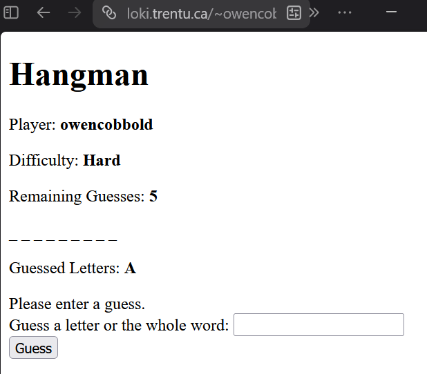

### Invalid Guess Error

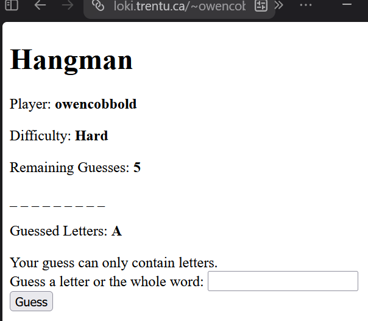

### Correct Letter Guess

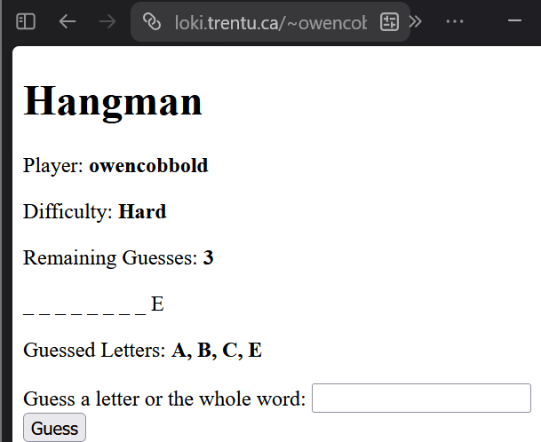

### Wrong Letter Guess

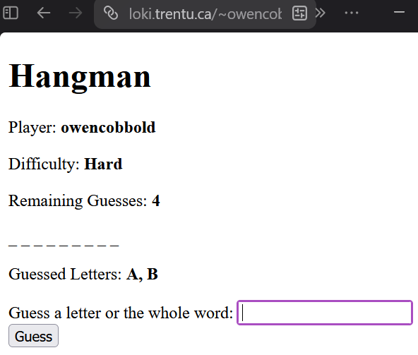

### 
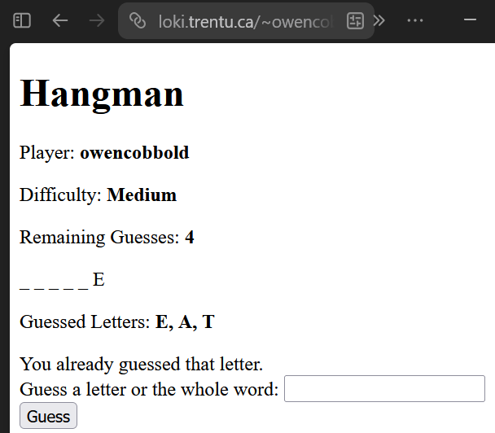

### Win Screen

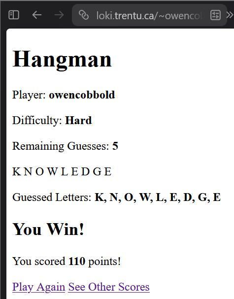

### Game Over Screen

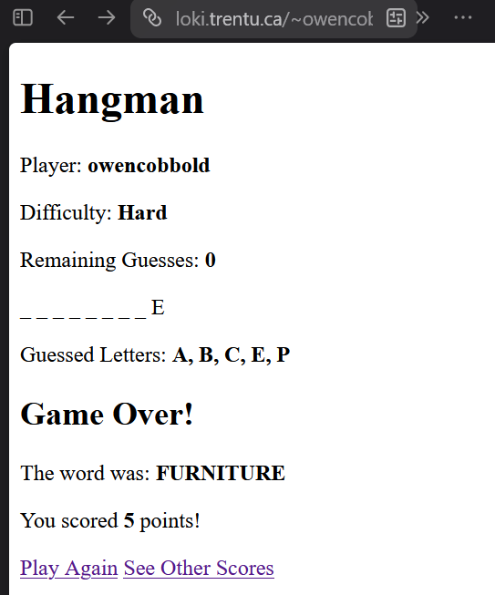

### Play Again

### HTML Validation

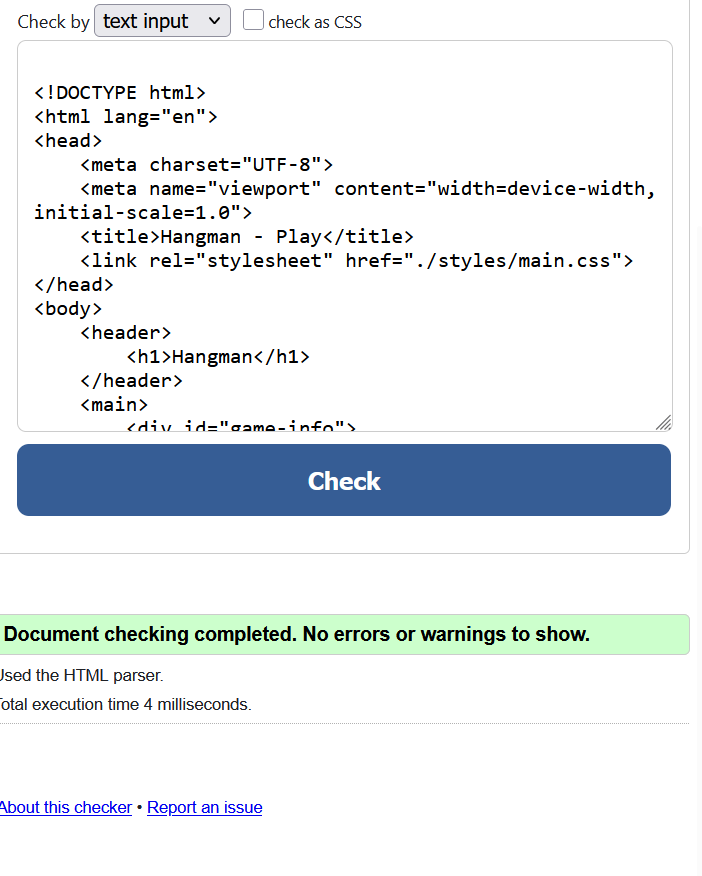

## scores.php

Loki Link: [scores.php Loki](https://loki.trentu.ca/~owencobbold/3430/assn/assn1-OwenCobbold21/scores.php)

### 

